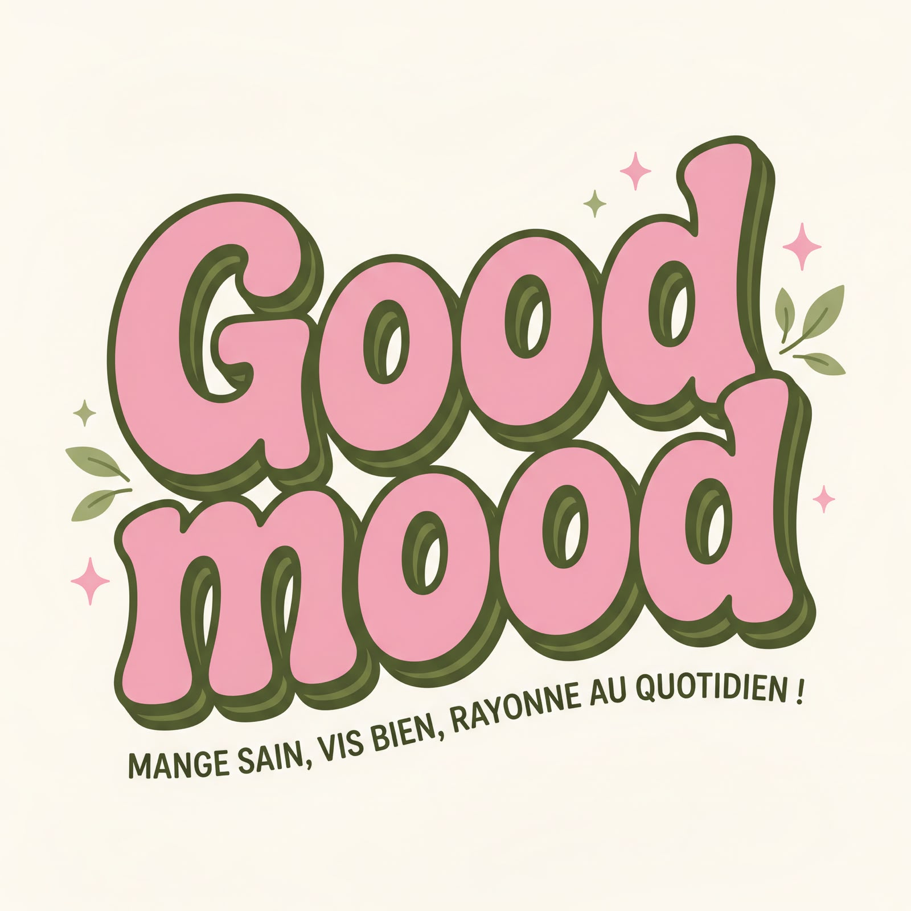

 

  

<h1 align="center">GOODMOOD</h1>

  <strong>La pause qui met de bonne humeur.</strong>

  
  

---

## Présentation

GOODMOOD est un projet de restauration rapide **100 % vegan**, développé dans le cadre d'un projet croisé entre l'ECE Lyon et Sup de Pub (2026–2027).

Notre objectif : rendre l'alimentation végétale gourmande, accessible et attractive auprès des jeunes de 18 à 30 ans.

## Aperçu

  

## Technologies

  
  
  
  
  

## Équipe

**ECE Lyon — Développement**
- Sore Ibrahim Chalide
- Kouassi Jean
- Abdollahi Fatemeh
- Bounouar Rayyan

**Sup de Pub — Communication**
- Lily Guilloret
- Laura Orcel

**Chef de projet :** Sore Ibrahim Chalide

---

  <strong>GOODMOOD</strong> 
  <em>Mange sain, vis bien, rayonne au quotidien !</em>

